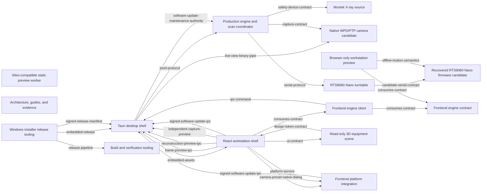

<!-- Generated by tools/verify/gen-module-graph.mjs. Do not edit by hand.
     Run `npm.cmd run module-map:generate` to regenerate. -->

# Module graph

An arrow `A --> B` means module A depends on module B. Impact analysis walks the arrows in reverse, because changing B can affect A.

## Modules

| Module | Risk | Responsibility | Required gates |
|---|---|---|---|
| `engine-core` | critical | Owns the JSONL API, safety gates, authoritative device state, and projection transaction ordering. | cargo test --manifest-path backend/Cargo.toml -p ct-engine |
| `device-xray` | critical | Owns Moxtek discovery, binary serial transport, measured readback, and fail-closed beam shutdown. | cargo test --manifest-path backend/Cargo.toml -p ct-engine devices::xray |
| `device-camera` | critical | Owns camera discovery, exposure configuration, host-side capture, and image-file confirmation. | cargo test --manifest-path backend/Cargo.toml -p ct-engine devices::camera |
| `device-turntable` | critical | Owns Nano identity validation, line protocol, motion acknowledgement, warning output, and emergency stop. | cargo test --manifest-path backend/Cargo.toml -p ct-engine devices::turntable |
| `turntable-firmware` | critical | Preserves the approved, hash-verified firmware source candidate and its reproducible offline build and real-source host harness. | node tools/build/build-turntable-firmware.mjs node tests/firmware/test-turntable-firmware.mjs cargo test --manifest-path backend/Cargo.toml -p ct-engine devices::turntable |
| `desktop-shell` | critical | Owns native dialogs and paths, sidecar lifecycle, and IPC forwarding without owning scan state. | cargo test --manifest-path backend/Cargo.toml --workspace npm.cmd run test:sites |
| `frontend-contract` | critical | Defines the TypeScript command and snapshot vocabulary shared by production and preview clients. | npm.cmd run typecheck npm.cmd run test:sites |
| `frontend-client` | high | Selects the runtime adapter and exposes engine snapshots to React without fallback after Tauri errors. | npm.cmd run typecheck npm.cmd run test:sites |
| `developer-preview` | high | Simulates device and scan behavior for browser development; it never accesses physical hardware. | npm.cmd run typecheck npm.cmd run test:sites |
| `ui-shell` | medium | Owns panels, menus, safety presentation, layout, themes, and static UI assets. | npm.cmd run typecheck npm.cmd run test:sites npm.cmd run build |
| `scene` | medium | Owns visualization geometry, theme conversion, camera navigation, and WebGL fallback. | npm.cmd run typecheck npm.cmd run test:sites |
| `platform` | medium | Provides desktop-only paths, dialogs, directory reveal, and log export behind small functions. | npm.cmd run typecheck npm.cmd run test:sites |
| `build-tooling` | medium | Owns dependency locks, build entry points, contract tests, module-map generation, and impact analysis. | npm.cmd run module-map:check npm.cmd run test:sites |
| `extensions` | low | Holds the optional static hosted-preview worker that serves built assets, outside the desktop application and the safety control loop. | npm.cmd run test:sites npm.cmd run build |
| `documentation` | low | Explains current architecture, operating constraints, historical plans, and verification evidence. | npm.cmd run module-map:check |
| `release-artifacts` | medium | Owns installer templates, immutable versions, release signatures and identity verification; generated packages are excluded from source ownership. | npm.cmd run module-map:check npm.cmd run test:desktop |

## Hidden or semantic dependencies

| Consumer | Provider | Type | Strength | Reason |
|---|---|---|---|---|
| `device-turntable` | `turntable-firmware` | candidate-serial-contract | strong | The prescribed-direction planner and Nano protocol share the recovered source candidate's pulse scale, capture hold IDs and HOME exceptions; hardware flash consistency remains a separate acceptance gate. |
| `developer-preview` | `turntable-firmware` | offline-motion-semantics | strong | Preview preserves negative ordinary moves, bounded HOME exceptions and confirmed capture hold semantics from the candidate without representing hardware evidence. |
| `release-artifacts` | `build-tooling` | release-pipeline | strong | installer:build compiles current theme assets and packages the desktop app, license texts and verified adjacent engine in the sole latest Windows MSI; build metadata stays in the local evidence cache. |
| `release-artifacts` | `desktop-shell` | embedded-release | strong | The MSI installs the desktop host, frontend assets and the SHA-256-verified engine in one chosen directory. |
| `desktop-shell` | `ui-shell` | embedded-assets | strong | Tauri embeds current frontend assets and shares its 1920x1080 design baseline; DPI-aware window limits and edge-to-edge client filling must stay aligned. |
| `ui-shell` | `frontend-client` | consumes-contract | strong | UI actions and rendering depend on the client hook and complete engine snapshots. Applied setpoints require device confirmation; Pause retains acquisition ownership, and operator Stop releases it only after the engine commits confirmed cleanup and task closure. |
| `frontend-client` | `frontend-contract` | consumes-contract | strong | Both adapters implement the snapshot contract, including nullable measured telemetry, on/off/unknown beamState and engine-issued camera property/option support and effective write permissions; failed IPC invalidates displayed readings. |
| `developer-preview` | `frontend-contract` | consumes-contract | strong | Preview output must stay structurally and semantically compatible with production snapshots. |
| `frontend-client` | `desktop-shell` | ipc-command | strong | Tauri invoke command names and payload fields are string-based runtime contracts. |
| `ui-shell` | `desktop-shell` | frame-preview-ipc | strong | The frame_preview command accepts a committed frame index and returns an embedded JPEG from the engine-registered, hash-verified NEF. |
| `desktop-shell` | `device-camera` | live-view-binary-pipe | strong | An internal engine-issued user-ACL endpoint carries bounded JPEG envelopes and a version-2 session/sequence delivery acknowledgement; the desktop retries transient instance gaps only within the existing deadline, validates session/sequence/codec/dimensions before acknowledging, and the renderer can supply only afterSeq. |
| `ui-shell` | `platform` | camera-preset-native-dialog | strong | Camera presets import/export through native JSON dialogs; the domain validates the entire schema and active capabilities before persistence or explicit Apply. |
| `ui-shell` | `desktop-shell` | reconstruction-preview-ipc | strong | The reconstruction_preview command accepts only a method ID and returns an engine-registered, hash-verified preview volume for a completed reconstruction. |
| `desktop-shell` | `engine-core` | jsonl-protocol | strong | JSONL v2 validates request ID/sequence/session and returns complete snapshots plus operation records; Stop/state remain available during background device work. Cancelled or stale ordinary jobs cannot commit; uncancelled complete/abandon/deleted-directory register writes finish atomic persistence and owner commit across repeated Stop. |
| `engine-core` | `device-xray` | safety-device-contract | strong | Every exposure transaction depends on verified X-ray readback and fail-closed shutdown. |
| `engine-core` | `device-camera` | capture-contract | strong | Projection commit requires a confirmed host-side image file. |
| `engine-core` | `device-turntable` | serial-protocol | strong | Motion, warning, emergency stop, and CAPTURE_DONE use the external Nano protocol. |
| `ui-shell` | `scene` | ui-contract | strong | The application supplies angleKnown, signed rotationDirection, task identity and feedback freshness; scene interpolation must never predict device motion or update scan state. |
| `scene` | `ui-shell` | design-token-contract | medium | Scene colors and visibility semantics must follow the shared theme and safety state. |
| `ui-shell` | `platform` | platform-service | medium | Directory selection and log export cross the browser-to-desktop boundary. |
| `ui-shell` | `desktop-shell` | independent-capture-preview | strong | Capture-ID-only IPC resolves engine registration, rechecks byte bounds/hash and rejects stale descriptors without renderer paths. |
| `desktop-shell` | `engine-core` | software-update-maintenance-authority | strong | Install/replace requires matching session/operation maintenanceLocked ready report with device cleanup and no transactions before EOF and owned-process exit zero. |
| `ui-shell` | `desktop-shell` | signed-software-update-ipc | strong | Restricted update check/download/status/cancel/confirm actions share verified state and never accept renderer endpoints, keys or package paths. |
| `release-artifacts` | `desktop-shell` | signed-release-manifest | strong | Windows MSI assets and signed update containers share version/target/kind/size/hash and data/global signature validation with a fixed public key. |
| `platform` | `desktop-shell` | signed-software-update-ipc | strong | Platform updater functions bind check/download/status/cancel/confirmed apply to restricted desktop IPC; browser preview cannot invoke installation. |
